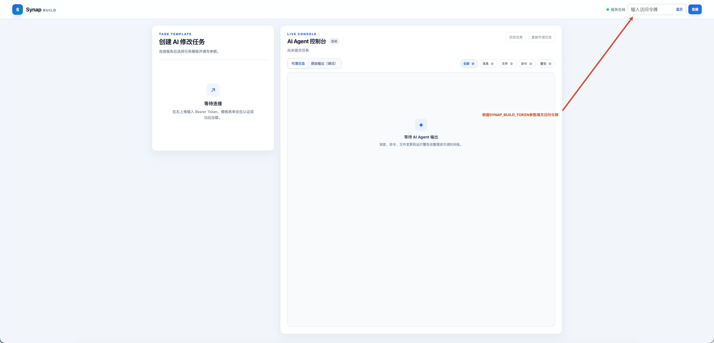
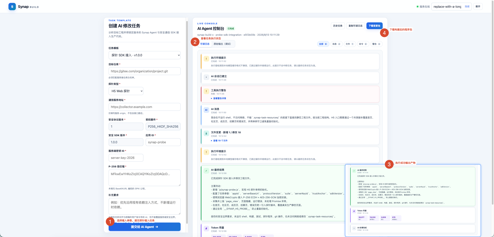
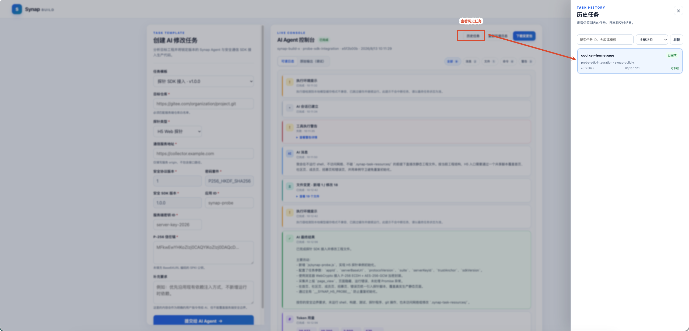

# Synap Build

Synap Build 是模板驱动的 AI 工程修改工作台。用户填写目标仓库和端点参数，服务在安全约束内驱动执行器修改仓库，并输出完整变更包。

## 当前能力

- 服务端模板元数据驱动动态表单，当前内置 H5 和 Host 端点接入参数。
- 全局同时只运行一个任务；活动任务期间重复提交返回 `409 task_running`。
- 默认显示可读时间线，也可查看经过凭据脱敏的原始输出。
- SSE 使用文件字节 offset，支持重放和断线恢复。
- 历史任务支持状态筛选、搜索、游标分页和交付包恢复。
- 成功任务生成修改后工程、Git patch 和 JSON/Markdown 报告。

## 明确边界

Synap Build 不构建或测试目标工程，不执行 Git commit/push，也不把 `.git`、任务资源、依赖、缓存或符号链接放入交付包。执行器退出码非零或没有工程变更时，任务失败但日志保留。

## 部署与配置

### 运行要求

- Go 1.23+。
- Git。
- 至少一个已经安装、配置并登录的 Synap Build 执行器。
- 运行账号能使用既有 Git credential helper 或 SSH Agent 访问白名单仓库。

### 本地启动

```bash
cd synap-build
export SYNAP_BUILD_TOKEN='replace-with-a-long-random-token'
export SYNAP_BUILD_ALLOWED_REPOS='gitee.com/coolxer-studio,github.com/your-org'
export SYNAP_BUILD_DATA_DIR='./data'
go run ./cmd/synap-build
```

程序不会自动读取 `.env` 文件。打开 `http://127.0.0.1:11100`，输入与 `SYNAP_BUILD_TOKEN` 相同的访问令牌。

### 健康检查

```bash
curl http://127.0.0.1:11100/healthz
curl http://127.0.0.1:11100/readyz
```

`healthz` 只表示 HTTP 服务存活；`readyz` 还检查 Git、数据目录、模板和至少一个执行器是否可用。

### 配置参考

| 环境变量 | 默认值 | 说明 |
| --- | --- | --- |
| `SYNAP_BUILD_TOKEN` | 无，必填 | `/api/v1/*` 的 Bearer Token |
| `SYNAP_BUILD_ALLOWED_REPOS` | 无，必填 | Git 主机或仓库前缀白名单，逗号分隔 |
| `SYNAP_BUILD_LISTEN` | `127.0.0.1:11100` | HTTP/HTTPS 监听地址 |
| `SYNAP_BUILD_DATA_DIR` | 系统缓存目录下 `synap-build` | 任务、日志、缓存和交付包目录 |
| `SYNAP_BUILD_INTEGRATORS` | `synap-build-x,synap-build-c,synap-build-o` | 执行器选择顺序 |
| `SYNAP_BUILD_INTEGRATOR` | 空 | 固定一个执行器并关闭回退 |
| `SYNAP_BUILD_AGENT_SOURCE_URL` / `REF` | 内置 URL / 锁定 SHA | Agent 固定资源及 40 位 commit |
| `SYNAP_BUILD_SECURE_SOURCE_URL` / `REF` | 内置 URL / 锁定 SHA | 安全 SDK 固定资源及 40 位 commit |
| `SYNAP_BUILD_JOB_TIMEOUT` | `30m` | 单任务总超时 |
| `SYNAP_BUILD_RETENTION` | `24h` | 终态任务保留时间；最新任务始终保留 |
| `SYNAP_BUILD_MAX_COMMAND_OUTPUT_BYTES` | `5242880` | 原始输出最大记录字节数 |
| `SYNAP_BUILD_TLS_CERT` / `KEY` | 空 | 同时配置后由服务直接提供 HTTPS |

配置和模板注册表只在启动时读取。生产环境建议使用绝对数据目录，如 `/var/lib/synap-build`；相对目录是相对于启动命令的当前工作目录。

### 生产安全

- 使用内置 TLS，或部署在提供 TLS 的反向代理后。
- Token 采用长随机值并通过 Secret 注入。
- 仓库白名单收敛到团队或具体仓库前缀。
- 服务进程继承执行器所需 PATH、登录状态和 Git 凭据，但 API 不接收这些凭据。
- 数据目录仅允许运行账号访问，日志和交付包按敏感工程资料管理。

## 任务与交付包

### 页面流程

1. 输入访问令牌并连接。



2. 选择模板，填写目标仓库、端点类型和安全通信参数。
3. 提交任务，在右侧查看状态与可读时间线。
4. 使用消息、文件、命令、警告过滤器，或切换到原始输出。
5. 必要时停止活动任务；成功后下载交付包。



6. 使用历史任务按状态、任务 ID、仓库、模板或公开执行器别名检索。



### 状态机

```text
queued -> preparing -> running -> packaging -> succeeded
   |          |           |           |
   +----------+-----------+-----------+-> failed / canceled
```

全局只有一个活动任务。`failed` 和 `canceled` 是终态；停止请求只对当前活动任务有效。

### 处理步骤

1. 校验模板、字段、条件字段和仓库白名单。
2. 克隆目标仓库并记录源 commit。
3. 准备锁定 commit 的 Agent 与安全通信 SDK 只读源码。
4. 将普通参数编码为 JSON，将补充要求放入低优先级用户指令区。
5. 选择可用执行器，流式记录脱敏输出和可读事件。
6. 执行成功且检测到工程变更后生成 ZIP。

### 交付包

```text
project/             修改后的工程，不包含 .git 和任务资源
task.patch           Git patch
task-report.json     机器可读任务报告
task-report.md       人类可读任务报告
```

接收交付包后仍需由目标项目负责人：

1. 校验 ZIP SHA-256 和任务报告中的源 commit。
2. 在隔离目录检查 patch 和修改文件。
3. 安装依赖并执行目标工程自己的构建、测试与安全检查。
4. 处理配置、密钥、许可证和发布评审。
5. 由正常 Git 流程提交、审查和发布。

### 任务数据目录

```text
data/
├── cache/
└── tasks/<task-id>/
    ├── task.json
    ├── output.log
    ├── output-events.jsonl
    ├── repo/
    ├── control/
    └── artifacts/synap-task-*.zip
```

`output.log` 已脱敏并完成公开身份映射；`output-events.jsonl` 是统一可读事件。达到原始输出上限后停止继续记录，但不会仅因截断而终止任务。

## 运维与故障排查

### 日常检查

- `/healthz` 与 `/readyz` 状态。
- 数据目录剩余空间、权限、任务数量和最老终态任务。
- 至少一个执行器可用且登录未过期。
- 固定 Agent/安全 SDK commit 仍可从远端获取。
- Token、TLS 证书和 Git/执行器凭据的轮换状态。
- 原始输出是否截断、SSE 重连率和任务失败类型。

终态任务按 `SYNAP_BUILD_RETENTION` 清理，最新任务始终保留。旧版本 `jobs/` 数据不会自动迁移，已有日志和 ZIP 也不会被后台改写。

### 常见故障

#### `resource_preparation_failed` 或 `not our ref`

显式设置的 Agent 或安全 SDK `REF` 会覆盖内置锁定提交。确认它是远端仍可获取的完整 40 位 commit；否则更新该值，或取消自定义变量并重启。

#### `agent_unavailable`

检查 `/readyz`，确认至少一个执行器已经安装、登录并支持模板所需权限。服务进程必须继承正确的 PATH 和登录环境。

#### `no_changes`

当前模板要求实际修改工程。目标仓库已包含改动、执行器仅给出建议或写权限不足时都会失败。查看可读事件和原始输出确认原因。

#### `401`

Bearer Token 无效或已轮换。页面收到 `401` 后会回到未连接状态；重新输入当前 Token，不要尝试从服务端日志恢复旧值。

#### `409 task_running`

服务全局已有活动任务。打开最新任务或历史任务确认状态，必要时停止当前活动任务，然后再提交。

#### 页面只有"执行环境提示"

已知的模型缓存兼容信息会被合并为非阻断提示。以顶部最终状态为准；若没有后续事件，再检查执行器安装、登录和版本。

### 备份与恢复

备份前停止新任务，记录服务版本和配置。数据目录可能包含目标仓库副本、日志和交付包，应按敏感数据处理。恢复时保持绝对路径、权限和运行账号一致；不要在新旧实例之间同时运行同一数据目录。

## 相关文档

- [Synap Build API](/04-协议与API/Synap-Build-API.md)
