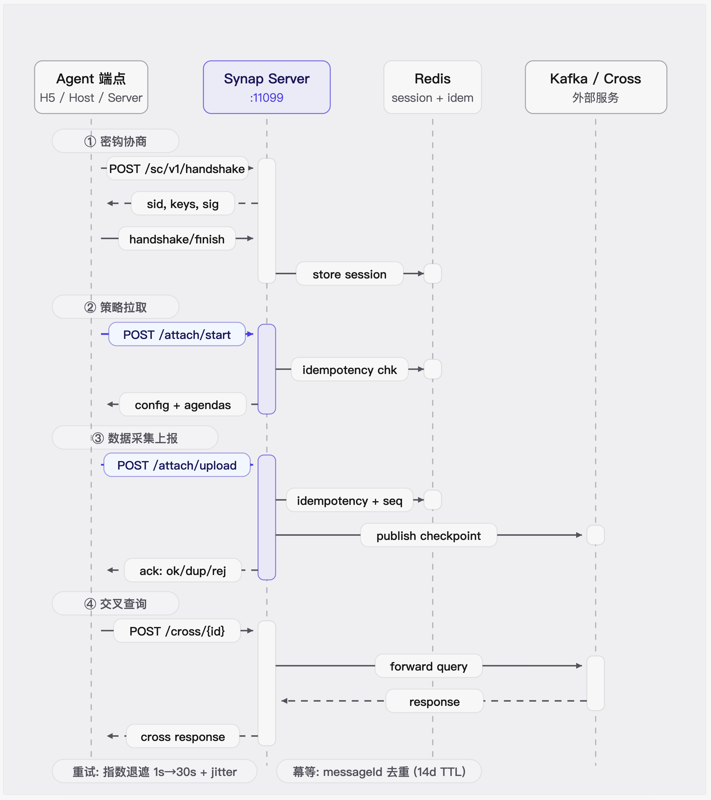

# 协议与 API

本章用于联调和二次开发。生产接入应优先使用各平台 Agent SDK，而不是自行拼装加密信封或直接调用逻辑 Controller。

## 接口分层

| 层次 | 内容 | 使用者 |
| --- | --- | --- |
| 安全传输层 | `/sc/v1/handshake`、`/finish`、`/message` | Agent SDK |
| Server 逻辑层 | `/attach/start`、`/attach/upload`、`/cross/{id}` | 仅由安全层解密后转发 |
| Fact 与规则层 | checker、Fact、Agenda、Punish、Checkpoint | Server 和规则开发者 |
| Build API | `/api/v1/templates`、`/api/v1/tasks*`、SSE | Synap Build 页面或受控客户端 |

## 安全通信协议 v1

协议 v1 使用 `P-256 + HKDF-SHA256 + AES-256-GCM`。业务 method、逻辑 path、受保护
header 和正文位于密文内，外层 requestId 通过 AAD 认证。生产部署在 TLS 1.2+ 上运行；
部分 Agent 的当前配置校验也接受 HTTP，供受控开发环境使用，但应用层加密不替代 TLS。
Server 的 `SYNAP_SC_REQUIRE_TLS` 默认仍为 `true`；仅修改 Agent URL 不会启用 HTTP 联调。

### 整体流程



上图展示了 Agent 与 Server 之间从密钥协商到数据上报的完整通信链路，共四个阶段：

#### ① 密钥协商

Agent 启动后，通过安全通信协议 v1 与 Server 完成三步握手，建立端到端加密会话：

1. Agent 发起 `POST /sc/v1/handshake`，携带 `appId`、`deviceType`、临时 P-256 公钥（`clientEphemeralPublicKey`）和安装标识公钥（`installationPublicKey`）。原生端点还需提供一次性 `enrollmentToken`。
2. Server 返回会话 ID（`sid`）、密钥 ID（`kid`）、服务端 P-256 公钥和 ECDSA 签名。Agent 验证签名后确认服务端身份。
3. Agent 发送 `POST /sc/v1/handshake/finish`，提交对握手记录的签名证明（`proof`）。Server 验证通过后激活会话。
4. Server 将会话密钥和元数据写入 Redis（`synap:sc1:session`，带 TTL），双方通过 HKDF-SHA256 派生 AES-256-GCM 对称密钥。

此后所有业务消息均通过 `POST /sc/v1/message` 加密传输，密文信封包含 `sid`、`seq`（序列号）、`rid`（请求 ID）、`nonce` 和加密载荷（`ct`），附带 AAD 防篡改。

#### ② 策略拉取

Agent 发起启动请求，获取采集策略和初始风险判定：

- Agent 发送加密消息，内层逻辑路径为 `/attach/start`。请求体包含 `common` 数组（24 个字段：用户、设备、网络、地理位置等）和 `meta`（`messageId`、`batchId`、`sessionId`、`appKeyId` 等）。
- Server 从 Redis 检查 `messageId` 幂等性（`synap:{platform}:message:{appId}:{startId}:{messageId}`），防止重复处理。
- Server 构建 `StartFact`（如 `H5StartFact`、`ServerStartFact`），执行 Groovy 规则引擎生成 `Checkpoint`。
- Server 返回 `ResponseVO`，包含 `startConfig`（采集开关、检查间隔、上报间隔）、`agendas`（风险议题列表）和 `risk`（风险评估）。

Agent 根据返回的 `startConfig` 调整本地采集行为，进入数据采集循环。

#### ③ 数据采集上报

Agent 按策略配置采集 Fact 数据，批量加密上报并等待 ACK 确认：

- Agent 将采集到的事实数据（如 `DeviceData`、`UserData`、`BehaviorData` 等）打包为 `data[]` 数组，通过加密消息以逻辑路径 `/attach/upload` 发送。每条 Fact 携带 `messageId`、`sequence`、`observedAt` 等元数据。
- Server 从 Redis 检查幂等性（`messageId` 去重，处理租约 5 分钟，完成态 TTL 14 天）和序列号（检测间隙与乱序，`synap:{platform}:sequence:{appId}:{startId}:{guid}`）。
- Server 逐条 Fact 反射构建 Fact 类、执行 Groovy 规则、生成 `Checkpoint`，并将结果发布到 Kafka（topic 前缀 `server_fact_*`）供下游消费。
- Server 返回 ACK，包含 `acceptedMessageIds`（已接收）、`duplicateMessageIds`（重复跳过）和 `rejectedItems`（拒绝项，标注 `retryable` 标志）。Agent 清除已确认消息，对可重试的拒绝项保留入队等待重发。

#### ④ 交叉查询

Agent 可选地发起实时查询请求，获取外部服务的风险或标签数据：

- Agent 发送加密消息，逻辑路径为 `/cross/{id}`（如 `/cross/info`、`/cross/rating`、`/cross/label_start`）。
- Server 解密后通过 `RestTemplate` 将请求转发到配置的外部服务（`msg_api_config.json`）。
- 外部服务返回结果，Server 原样加密后返回给 Agent。

### 重试与容错

- **指数退避**：失败后从 1s 起步倍增，上限 30s，叠加 0.8–1.2x jitter 避免重试风暴。
- **幂等保证**：`messageId` 级别去重，确保网络重试不会产生重复处理。
- **本地队列**：Agent 端使用 IndexedDB 持久化消息队列，批量上报（默认 50 条/批），失败自动重排。

> 生产入口只有 `/sc/v1/handshake`、`/sc/v1/handshake/finish` 和 `/sc/v1/message`。`/attach/*` 与 `/cross/*` 是密文内的逻辑路径，不暴露为明文 HTTP 入口。

### 建立和使用会话

```text
Agent -> POST /sc/v1/handshake
Agent -> 验证 Server key ID 与固定 SPKI 信任锚
Agent -> POST /sc/v1/handshake/finish
Agent -> POST /sc/v1/message（加密 start / upload / cross）
Server -> 校验 seq、requestId、密文和逻辑路由
Server -> 加密返回业务响应与 ACK
```

### 身份模型

- Server 使用稳定的 P-256 身份密钥，Agent 按 key ID 固定公钥。
- 原生端、Host 和 Server Agent 首次安装使用短时单次注册令牌。
- H5 无法安全保存部署 Secret；其 appId 是公开标识，安装身份存于当前 Origin 的 IndexedDB。
- 会话、重放窗口和安装身份记录存于 Redis，并使用独立命名空间。

### 两组顺序标识

| 标识 | 层次 | 重试规则 |
| --- | --- | --- |
| `messageId` / `batchId` / 业务 `sequence` | Fact 业务层 | 同一业务消息重试时保持不变 |
| 传输 `seq` / `requestId` | 安全通信层 | 每次网络传输重新生成并重新加密 |

安全 SDK 不自动重试业务 POST。重试由 Agent 队列负责；超时后不能简单生成新 messageId，否则会破坏幂等。

### 失败原则

- key ID、信任锚、注册令牌或密文无效时拒绝，不回退明文。
- 逻辑路径不在白名单时拒绝。
- 重放、sequence 异常、请求过大或字段超限时返回明确错误或观察信号。
- 生产 ACK 客户端只有收到 accepted/duplicate 才清除本地记录；iOS 当前 upload 尚未完成
  该契约，因此只能条件联调。

> TLS 终止代理必须处于受控边界。即使使用应用层加密，也不能关闭 TLS 或忽略证书验证。

## Fact 与规则模型

### 构造约定

普通平台通过命名约定反射构造 Fact：

```text
platform=android + type=DeviceData
=> com.coolxer.model.fact.android.AndroidDeviceFact
```

规则脚本按 Fact 类名对应：

```text
AndroidDeviceFact -> AndroidDeviceFactRule.groovy
```

checker 配置决定字段顺序和采集策略。平台名、type、类名、配置 key 或脚本名不一致，会导致构造或规则执行失败。

当前 Server 已为 Android 显式允许 `ActivityData`、`AnrData`、`AppData`、`DeviceData`、
`EventData`、`FileData`、`InjectData`、`JavaData`、`LocationData`、`NativeData`、`NetData`、
`PrivacyData`、`RuntimeData`、`SelfAppData` 和 `UserData`。Android 的旧检测器集合可能超过
通用单节点结构限制，但仍受请求体字节数和 Fact 数量上限约束。

HarmonyOS 与 ESP32 的客户端 Fact 当前只是待接入契约：Server 尚无对应类型白名单、
Fact 类、checker、规则和 topic，不能因为客户端能生成 JSON 就视为已支持。

### Server 应用 Fact

`synap-server` 将 `server` 作为安全通信协议 v1 平台接收。外部接口仍只有 `/sc/v1/**`，解密后的允许逻辑路径为 `/attach/start`、`/attach/upload` 和已有 `/cross/*`；没有新增明文 Controller。

所有服务端应用 Fact 使用显式命名字段，`schemaVersion` 固定为 `1`，并携带 `messageId`、`observedAt` 和 `sequence`。当前类型包括：

- `ApplicationData`
- `RuntimeData`
- `ApiAssetData`
- `ApiObservationData`
- `SecurityConfigData`
- `DependencyData`
- `DangerousCallData`
- `SecurityEventData`
- `AgentHealthData`
- `UserData`
- `ActionData`

Server 对类型、字段白名单、枚举、大小和嵌套结构做严格校验；未知字段会被永久拒绝。ACK、幂等、sequence 与 Kafka Checkpoint 沿用现有协议语义。Server 应用 topic 使用 `server_fact_*` 前缀，规则来自 `Server*FactRule.groovy`，风险进入现有 `RiskAssessment`、Agenda 与 Punish 建议链路。

### Checker 策略

`deploy/open_config/checker_config/server.json` 返回采样窗口、API 最大资产数、依赖目录策略，以及 Agent 可识别的固定阻断规则 ID。Server 返回的 punish 仅是建议，Agent 只会执行本地内置且本地允许列表启用的规则，服务端不能下发代码或任意表达式。

### 规则输出

规则生成 Agenda，再由 punish 配置映射动作建议。风险输出包含：

```text
detectorVersion / ruleVersion / reasonCodes /
evidenceCount / confidence
```

新规则默认 `observation=true`。风险分数按会话聚合并随时间衰减，单个客户端信号不应直接触发高风险处罚。

### 依赖漏洞数据

Server Agent 可读取本地 OSV Maven JSON 或 gzip JSON 快照。配置项：

```yaml
synap:
  vulnerability:
    osv:
      path: /opt/synap/catalog/osv-maven.json.gz
```

支持普通 JSON 或 gzip JSON；根节点可以是 OSV 数组，也可以使用 `vulnerabilities` 数组。Provider 按 Maven purl 和版本匹配显式 `versions` 及 OSV `ranges.events` 的 `introduced`、`fixed`、`last_affected`，输出 OSV/CVE alias、CVSS 与修复版本。文件按修改时间热加载，请求链路不访问公网。依赖漏洞只生成风险和 Agenda，不参与 Agent 运行时阻断。

部署流程负责原子替换本地快照。当前实现会在新的 `DependencyData` 或重放依赖资产时使用新快照重新计算；若要对历史库存立即全量重算，应由下游资产存储重放已有 Dependency Checkpoint。

## 阅读导航

- [Server API](Server-API.md)
- [Synap Build API](../03-Synap-Build接入/Synap-Build-API.md)

Server 完整字段定义以 [Server API](Server-API.md) 为准；Synap Build API 以 `synap-build/internal/assets/openapi.yaml` 为准。摘要页提供推荐入口和运维所需信息。
