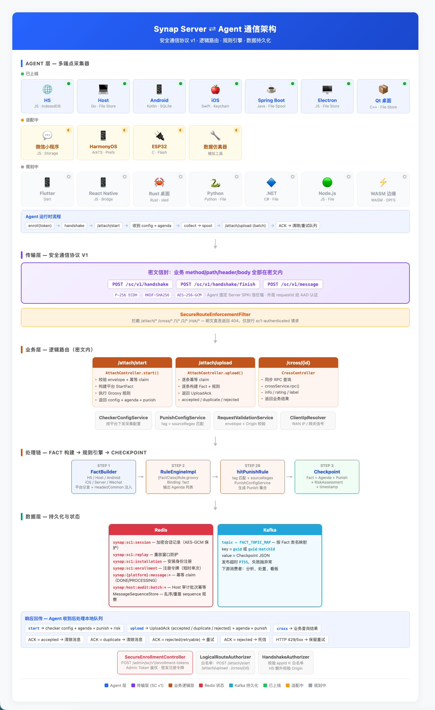

# Synap 整体架构

> Synap 是以配置驱动的端点执行器，用于资产梳理、数字化运营、安全风险管控等场景下的数据采集与动态策略执行。

整体架构分为五层：**Agent 层 → 传输层 → 业务层 → 处理链 → 数据层**。各层之间通过明确契约解耦，可独立演进。



---

## 一、Agent 层 — 多端点采集器

Agent 是 Synap 的数据采集端点，运行在目标设备或应用进程中。所有 Agent 共享同一套安全通信协议，但按平台差异各自实现本地队列、身份存储和采集策略。

### 已上线

| Agent | 技术栈 | 身份存储 | 本地队列 |
| --- | --- | --- | --- |
| H5 | JavaScript | IndexedDB | MessageQueue (sessionStorage) |
| Host | Go | 文件系统 | 有界文件队列 |
| Android | Kotlin / Java | SQLite | 持久 SpoolStore |
| iOS | Swift | Keychain | 持久队列 (适配中) |
| Spring Boot | Java | 文件系统 | 有界文件 Spool |
| Electron | JavaScript | 文件系统 | 文件队列 |
| Qt 桌面 | C++ | 文件系统 | 文件队列 |

### 适配中

| Agent | 技术栈 | 状态 |
| --- | --- | --- |
| 微信小程序 | JavaScript · Storage | 协议 v1 首版不可用，需适配小程序安全上下文 |
| HarmonyOS | ArkTS · Preferences | 协议 v1 客户端工程已有，Server 尚未注册 deviceType |
| ESP32 | C · Flash | 协议 v1 客户端工程已有，Server 尚未注册 deviceType |
| 数据仿真器 | 模拟工具 | 用于测试，非生产 Agent |

### 规划中

Flutter · React Native · Rust 桌面 · Python · .NET · Node.js · WASM 边缘

> iOS 已接入协议 v1 安全传输，但 upload 的 ACK/持久队列语义仍需补齐后再按其他生产 Agent 的验收标准放行。

### Agent 运行时流程

```
enroll(token) → handshake → /attach/start → 收到 config + agenda
→ collect → spool → /attach/upload (batch) → ACK → 清除/重试队列
```

1. **注册**：通过 Admin 签发的 enrollment token 完成安装身份注册。
2. **握手**：与 Server 执行 P-256 ECDH 密钥交换，建立 AES-256-GCM 加密会话。
3. **启动上报**：发送 `/attach/start`，携带设备信息和应用上下文。Server 校验后下发 checker 配置、agenda 和 punish。
4. **数据采集**：按 checker 配置采集数据，写入本地队列（SpoolStore / MessageQueue）。
5. **批量上传**：通过 `/attach/upload` 批量上报 Fact，每条消息携带 `messageId` 用于幂等。
6. **ACK 处理**：
   - `accepted` 或 `duplicate` → 清除本地消息
   - `rejected` (retryable) → 保留队列重试
   - `rejected` (永久) → 进入死信
   - HTTP 429/5xx → 保留重试

---

## 二、传输层 — 安全通信协议 v1

传输层是 Agent 与 Server 之间的唯一网络入口。所有业务请求（method、path、header、body）都封装在密文信封内，外部观察者无法获取业务语义。

### 协议端点

| 端点 | 作用 |
| --- | --- |
| `POST /sc/v1/handshake` | 发起握手，携带 appId、deviceType、keyId |
| `POST /sc/v1/handshake/finish` | 完成 P-256 ECDH 密钥交换 |
| `POST /sc/v1/message` | 加密业务请求（方法、路径、头、体全在密文内） |

### 密码套件

- **密钥交换**：P-256 ECDH
- **密钥派生**：HKDF-SHA256
- **消息加密**：AES-256-GCM
- **信任锚**：Agent 内置 Server SPKI 固定信任锚，防中间人
- **重放保护**：requestId 经 AAD 认证，Redis 维护重放窗口
- **时钟偏差**：允许 ±5 分钟

### 路由强制

`SecureRouteEnforcementFilter` 拦截所有明文直连请求：

- `/attach/*`、`/cross/*`、`/1/*`、`/2/*`、`/risk/*`、`/device_index/*` — 明文直连返回 404
- 仅放行带有 `sc1-authenticated` 信任标记的请求（即经 SC v1 解密后的内部路由）

`LogicalRouteAuthorizer` 进一步限制逻辑路由白名单，仅允许：

- `POST /attach/start`
- `POST /attach/upload`
- `POST /cross/{id}`（id 仅允许 1-64 位字母、数字、`_`、`-`）

`HandshakeAuthorizer` 校验：

- `appId` 必须在 `SYNAP_SC_ALLOWED_APP_IDS` 白名单内
- H5 Agent 额外校验 Origin（生产环境空值拒绝握手）

---

## 三、业务层 — 逻辑路由

业务请求经 SC v1 解密后进入逻辑路由。三个核心 Controller 处理不同的业务场景。

### /attach/start

**Controller**：`AttachController.start()`

1. 校验 envelope + 幂等 claim（key: `platform:appId:startId:messageId`）
2. 按 platform 分发，构建平台 StartFact（H5 / Host / Android / iOS / Server / Wechat）
3. 注入 Header（8 段）和 Common（24 项）上下文 — 包含 guid、platform、appId、sdkVersion
4. 执行 Groovy 规则
5. 返回 checker config + agenda + punish + risk assessment

### /attach/upload

**Controller**：`AttachController.upload()`

1. 逐条幂等 claim（`PROCESSING → DONE`，异常时 release 回滚）
2. 逐条构建 Fact + 执行 Groovy 规则
3. 返回 `UploadAck`：
   - `acceptedMessageIds` — 接受
   - `duplicateMessageIds` — 重复（已处理过）
   - `rejectedItems` — 拒绝（附原因 + retryable 标记）
4. 附带本次执行产生的 agenda 和 punish

### /cross/{id}

**Controller**：`CrossController.crossTarget()`

1. 同步 RPC 查询
2. `crossService.rpc()` 转发到下游业务系统
3. 支持 `info`、`rating`、`label` 等查询类型
4. 返回业务查询结果

### 配置服务

| 服务 | 职责 |
| --- | --- |
| CheckerConfigService | 按平台下发采集字段、窗口和策略配置 |
| PunishConfigService | 按 tag + sourceRegex 匹配 agenda 生成 punish 动作建议 |
| RequestValidationService | 校验 envelope 结构、code/common 完整性、Origin 白名单 |
| ClientIpResolver | 从可信代理提取 WAN IP 和网关信号 |

---

## 四、处理链 — Fact → 规则 → Checkpoint

业务请求通过逻辑路由后进入处理链。处理链是 Server 的核心逻辑引擎，将原始采集数据转换为结构化风险判断。

### Step 1: FactBuilder

按平台分发构建对应 Fact 类型：

- H5Fact / HostFact / AndroidFact / iOSFact / ServerFact / WechatFact
- 注入 Header（8 段身份标识）和 Common（24 项传输上下文）
- 补充来源 IP、网关信号、传输时间等上下文字段

### Step 2: RuleEngineImpl

- 加载 Groovy 脚本：`{FactClassName}Rule.groovy`
- 将 Fact 作为 binding 注入脚本
- 脚本执行后输出 `Agenda` 列表（议题：检测到的问题或状态）
- 规则脚本与 Fact 结构形成数据契约，必须同版本发布

### Step 2b: hitPunishRule

- 按 Agenda 的 tag 匹配 `PunishConfigService` 中的 punish 规则
- `sourceRegex` 进一步限定来源匹配
- 生成 `Punish` 集合 — 动作建议（ALLOW / OBSERVE / PUNISH）

### Step 3: Checkpoint

将完整结果封装为 Checkpoint：

| 字段 | 说明 |
| --- | --- |
| Fact | 原始事实（含上下文注入） |
| Agenda | 规则输出的议题列表 |
| Punish | 动作建议集合 |
| RiskAssessment | 风险评分（h5/wechat/server 平台） |
| timestamp | 处理时间戳 |

---

## 五、数据层 — 持久化与状态

### Redis — 会话与业务状态

| Key 模式 | 作用 | TTL |
| --- | --- | --- |
| `synap:sc1:session` | 加密会话记录（AES-GCM 保护） | 10m |
| `synap:sc1:replay` | 重放窗口防护 | 10m |
| `synap:sc1:installation` | 安装身份注册 | — |
| `synap:sc1:enrollment` | 注册令牌（短时单次） | — |
| `synap:{platform}:message:{appId}:{startId}:{messageId}` | 幂等 claim（DONE / PROCESSING） | done: 14d, processing: 5m |
| `synap:host:audit:batch:{guid}:{batchId}` | Host 审计批次幂等 | — |
| MessageSequenceStore | 乱序 / 重复 sequence 观察 | 30m |

> 生产使用 Redis 保存安全会话、重放窗口、安装身份、注册令牌、messageId 幂等、业务 sequence 和风险状态。dev profile 的业务幂等、sequence 与风险状态使用有界内存，但启用安全通信时会话相关状态仍使用 Redis。

### Kafka — Checkpoint 持久化

| 配置 | 说明 |
| --- | --- |
| topic | 按 Fact 类名映射（`FACT_TOPIC_MAP`） |
| key | `guid` 或 `guid:batchId` |
| value | Checkpoint JSON |
| 发布超时 | `PT5S`，失败抛异常（保证 at-least-once） |
| 下游消费者 | 分析、存储、处置、看板 |

---

## 响应回传

Agent 收到 Server 响应后按 ACK 类型处理本地队列：

| ACK 类型 | Agent 动作 |
| --- | --- |
| `accepted` | 清除本地消息 |
| `duplicate` | 清除本地消息（Server 已处理过） |
| `rejected` (retryable=true) | 保留队列，重新加密重试 |
| `rejected` (retryable=false) | 进入死信 / 诊断状态 |
| HTTP 429 / 5xx | 保留重试（保持 messageId / batchId / sequence 不变） |

---

## 管理端点

| 端点 | 鉴权 | 作用 |
| --- | --- | --- |
| `POST /admin/sc/v1/enrollment-tokens` | Admin Token | 签发注册令牌（短时单次，用于 native / host / server agent） |

---

## 契约体系

Synap 的各层之间通过明确的数据契约约束，构成同一发布单元：

| 契约 | 职责 |
| --- | --- |
| checker | 定义各平台采集字段、窗口和策略 |
| Fact | 定义 Server 接受的事实结构 |
| rule (Groovy) | 将 Fact 转换为 Agenda 和风险证据 |
| punish | 将 Agenda 映射为动作建议 |
| topic | 规定 Checkpoint 的 Kafka 去向 |

> 这些内容必须作为同一发布单元验证，避免只升级某一层造成字段、命名或规则不匹配。

---

## 核心设计原则

1. **外部网络只有安全通信入口** — 逻辑业务路径不直接暴露
2. **业务消息和网络传输分别维护幂等与顺序标识** — messageId 用于业务幂等，seq/requestId 用于传输
3. **Agent 默认观察和 fail-open** — 保护动作受本地版本化规则约束
4. **checker、Fact、规则、Kafka topic 和文档共同构成数据契约** — 同版本发布
5. **Synap Build 只生成可审查交付物** — 不越过目标项目的构建发布流程

---

继续阅读：

- [系统与数据链路](系统与数据链路.md) — 运行时链路 Mermaid 全景图与关键参数
- [可靠性与幂等](可靠性与幂等.md) — 幂等状态机、sequence 观察和重试边界
- [安全与隐私](安全与隐私.md) — 密码套件、会话保护和隐私边界
