# 系统与数据链路

## 运行时链路

```mermaid
%% synap-wide-flow %%
flowchart LR
  subgraph agent["1. Agent / Server SDK"]
    direction LR
    collect["采集 Fact"] --> queue["本地有界队列 / 持久 spool"]
    queue --> businessIds["业务标识<br/>messageId / batchId / sequence<br/>同一业务消息重试时保持不变"]
  end

  subgraph protocol["2. HTTPS + 安全通信协议 v1"]
    direction LR
    handshake["POST /sc/v1/handshake<br/>appId / deviceType / keyId<br/>Origin 或单次 enrollment token"]
    trust["Agent 校验 Server key ID<br/>和固定 SPKI 信任锚"]
    finish["POST /sc/v1/handshake/finish<br/>P-256 + HKDF-SHA256<br/>建立 AES-256-GCM 会话"]
    message["POST /sc/v1/message<br/>sessionId / seq / requestId / ciphertext<br/>每次传输重新生成并加密"]
    handshake --> trust --> finish --> message
  end

  subgraph server["3. Synap Server"]
    direction TB
    decrypt["校验 TLS、会话、时钟、重放和 AAD<br/>解密 method / path / protected header / body"]
    route{"逻辑路由白名单<br/>仅允许 POST"}
    start["/attach/start<br/>下发 checker + 执行 StartFact 规则"]
    upload["/attach/upload<br/>批量 Fact + ACK"]
    cross["/cross/{id}<br/>id 仅允许 1..64 位字母、数字、_、-"]
    validate["业务请求校验<br/>code 8 段 / common 24 项<br/>meta / Origin / Fact 类型与结构"]
    reliable["可靠处理<br/>messageId 幂等 + sequence 观察"]
    fact["FactBuilder / StartFact<br/>补充来源、网关和传输上下文"]
    rules["Groovy Rule<br/>生成 Agenda / Punish / Risk"]
    response["逻辑响应<br/>status / config / agendas / punishes / risk<br/>ACK: accepted / duplicate / rejected"]
    encrypt["使用当前会话加密响应"]

    decrypt --> route
    route --> start --> validate
    route --> upload --> validate
    route --> cross
    validate --> reliable --> fact --> rules --> response --> encrypt
  end

  subgraph state["4. Redis 状态"]
    direction LR
    secureState["session / replay<br/>installation / enrollment"]
    businessState["messageId processing / done<br/>业务 sequence / risk"]
  end

  subgraph downstream["5. 下游系统"]
    direction LR
    kafka["Kafka Checkpoint"] --> analysis["分析、存储和处置"]
    services["Asset / Operation / Risk / Zenvis"]
  end

  businessIds --> handshake
  message --> decrypt
  handshake -. 身份与注册 .-> secureState
  finish -. 会话 .-> secureState
  decrypt -. 重放窗口 .-> secureState
  reliable <-. 幂等与 sequence .-> businessState
  rules <-. 风险聚合 .-> businessState
  rules --> kafka
  cross --> services --> response
  encrypt --> clientResult{"Agent 解密并判断结果"}
  clientResult -->|"accepted / duplicate"| clear["清除本地记录"]
  clientResult -->|"rejected 且 retryable=true<br/>或网络结果未知"| retry["保留队列并重试"]
  clientResult -->|"永久拒绝"| deadLetter["进入 dead-letter / 诊断状态"]
  retry -->|"保持 messageId / batchId / 业务 sequence<br/>生成新 seq / requestId 并重新加密"| message
```



### 关键参数

| 层次 | 配置或字段 | 当前默认值 / 约束 | 作用 |
| --- | --- | --- | --- |
| 密码套件 | `spring.sc.v1.allowed-suites` | `P256_HKDF_SHA256_AES256_GCM` | 身份协商、密钥派生与消息加密 |
| TLS | `SYNAP_SC_REQUIRE_TLS` | 生产默认 `true` | 应用层加密不能替代 TLS 1.2+ 与证书校验 |
| 身份准入 | `SYNAP_SC_SERVER_KEY_ID`、公私钥、`SYNAP_SC_ALLOWED_APP_IDS`、`SYNAP_SC_ENROLLMENT_ADMIN_TOKEN` | key ID 和 appId 为公开标识；私钥、会话记录密钥和令牌必须保密 | 固定 Server 身份并限制可握手客户端 |
| 浏览器准入 | `SYNAP_CORS_ALLOWED_ORIGINS`、`SYNAP_APP_ORIGINS` | 生产空值拒绝 H5 握手 | 校验 H5 Origin 与 appKeyId |
| 时间窗口 | `clock-skew` / `replay-ttl` / `session-ttl` | `5m` / `10m` / `10m` | 限制时钟偏差、重放窗口和会话寿命 |
| 安全信封 | `max-envelope-bytes` / `max-plaintext-bytes` | `500000` / `360000` 字节 | 限制 Base64/JSON 外层与解密后明文 |
| 业务请求 | `synap.security.max-body-bytes` / `max-facts` / `max-string-length` | `262144` 字节 / `100` 个 / `8192` 字符 | 限制逻辑请求体、Fact 数量和字符串长度 |
| 非 Android Fact 结构 | 深度 / Map / Collection / key | 深度 `6` / `128` 项 / `256` 项 / `64` 字符 | 阻止过深或过大的动态结构；Android 由各 Fact 构造器校验形状 |
| Header 与 common | `code` / `common` | `code` 必须为 8 段；`common` 固定 24 项且身份字段一致 | 绑定 guid、platform、appId 和 sdkVersion |
| 业务 meta | `protocolVersion`、`appKeyId`、`detectorVersion`、`batchId`、`sessionId`、`attempt`、`createdAt` | 协议版本为 `1`；appKeyId 和 detectorVersion 最长 `64`；batchId 最长 `128`；sessionId 必须等于 startId；attempt 和 createdAt 为正值 | 绑定版本、身份、批次、会话和重试次数 |
| 业务消息 | `messageId`、`observedAt`、`sequence` | messageId 最长 `128`；upload Fact 的 observedAt、sequence 为正值；带跟踪信息的 start 请求 sequence 固定为 `1` | 幂等消费、客户端观测时间和顺序观察 |
| 幂等状态 | `done-ttl` / `processing-ttl` | `P14D` / `PT5M` | 已完成消息保留 14 天，处理中租约 5 分钟 |
| 业务状态 | `sequence.ttl` / `risk.ttl` / `risk.half-life` | `PT30M` / `PT30M` / `PT15M` | sequence 观察及风险聚合、衰减 |
| Kafka | `KAFKA_PUBLISH_TIMEOUT` / partitions / replicas | `PT5S` / `1` / `1` | 控制 Checkpoint 发布等待时间和 topic 规模；生产按集群调整 |
| 可信代理 | `SYNAP_TRUSTED_PROXIES` | 生产默认空 | 只有命中 CIDR 的直接来源可以提供 Forwarded 和 `X-Synap-*` 信号 |

生产使用 Redis 保存安全会话、重放窗口、安装身份、注册令牌、messageId 幂等、业务 sequence 和风险状态；dev profile 的业务幂等、sequence 与风险状态使用有界内存，但启用安全通信时会话相关状态仍使用 Redis。

HarmonyOS 与 ESP32 已有协议 v1 客户端工程，但当前 Server 尚未注册对应 deviceType、
platform、checker 与 Fact，不能加入上述生产链路。iOS 已接入协议 v1 安全传输，但当前
upload 的 ACK/持久队列语义仍需补齐后再按其他生产 Agent 的验收标准放行。

## 工程接入链路

```text
接入人员 -> Synap Build 表单 -> 模板校验/仓库白名单
         -> 只读固定 SDK 资源 -> 受控执行器修改仓库
         -> 脱敏日志/可读事件 -> ZIP 交付包
         -> 项目团队构建、测试、评审和发布
```

Synap Build 不在运行时数据路径上。它帮助完成 Agent 工程修改，但交付后的应用仍按标准 Agent/Server 链路运行。

## 配置和契约

- checker：定义各平台采集字段、窗口和策略。
- Fact：定义 Server 接受的事实结构。
- rule：将 Fact 转换为 Agenda 和风险证据。
- punish：将 Agenda 映射为动作建议。
- topic：规定 Checkpoint 的 Kafka 去向。
- OpenAPI：规定 Synap Build 公共 HTTP/SSE 契约。

这些内容必须作为同一发布单元验证，避免只升级某一层造成字段、命名或规则不匹配。
