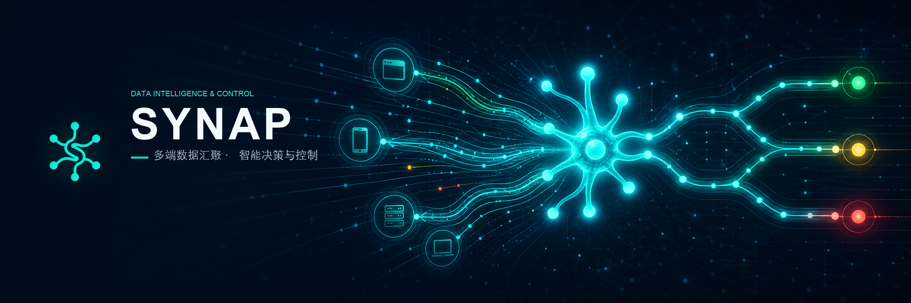
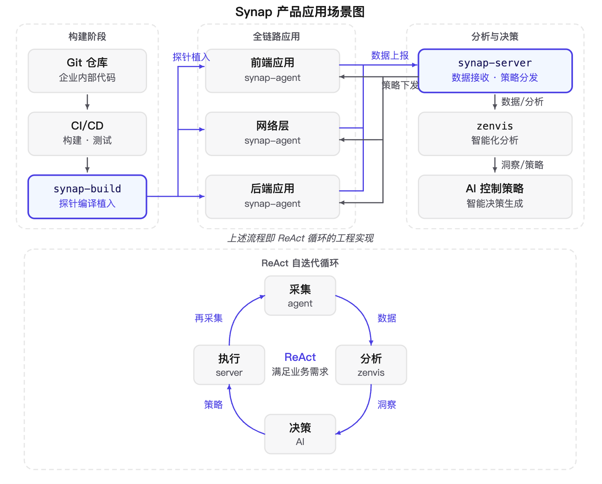

# Synap 可配置驱动的端点执行器

## 产品定位

Synap 是以配置驱动的端点执行器，用于资产梳理、数字化运营、安全风险管控等场景下的数据采集与动态策略执行。核心能力包括：

- **Checker 配置驱动**：通过 JSON 结构化配置定义各平台采集字段、窗口和策略，无需改代码即可扩展端点和调整采集范围。
- **安全通信协议 v1**：`P-256` + `HKDF-SHA256` + `AES-256-GCM` 端到端加密，Agent 固定 Server 信任锚。
- **Fact 规则引擎**：支持规则引擎语法将结构化事实转换为 Agenda 议题和 Punish 动作建议，支撑资产盘点、运营分析和风险管控。
- **多端点覆盖**：已经适配范围涵盖H5、Electron、Host、Qt、Spring Boot、Android、iOS，以及 HarmonyOS、ESP32 待适配。
- **工程化接入**：提供Synap Build 用模板驱动 AI 完成端点 SDK 自动接入，可对接企业侧CICD，输出可审查的交付包。

## 为什么做它

企业在端点数据采集与策略执行中面临的典型问题：

- **采集逻辑硬编码**：每新增一个端点平台或采集维度都要改服务端代码，字段、校验和策略耦合在业务逻辑中。
- **通信安全重复造轮子**：各端点自行实现加密、身份和重放防护，标准不统一，审计困难。
- **端点接入成本高**：新平台从协议适配到 SDK 集成需要大量手工工程，周期长、易出错。
- **策略执行分散**：资产盘点、运营观测和风险管控各自为政，缺少统一的采集—规则—处置闭环。

Synap 将这些重复能力抽象成统一的配置驱动框架，让端点接入、安全通信、数据采集和策略执行成为可组合、可演进的独立组件。

## 做这个产品的思路是什么

### 构建阶段：CI/CD 探针植入

企业内部 Git 仓库触发标准 CI/CD 流水线后，synap-build 在构建环节介入，将用户定义的数据采集与分析需求编译为探针，并植入到即将发布的应用产物中。

- **Git 仓库**：企业内部代码仓库，CI/CD 的触发源。
- **CI/CD**：标准构建与测试流水线，synap-build 作为其中一个构建步骤接入。
- **synap-build**：读取用户配置的采集任务，将对应的 synap-agent SDK 编译并植入到目标工程的构建产物中。

探针植入覆盖前端应用、网络层和后端应用三个层面，确保上线后的应用具备全链路数据采集能力。synap-build 不负责目标工程的构建、测试、提交、推送或生产发布，仅在构建过程中完成 Agent SDK 的受控接入。

### 运行时：全链路数据采集与策略执行

应用上线运行后，内嵌的 synap-agent 在前端、网络层和后端三个层面实时采集运行数据，并上报给 synap-server。

#### 数据上报

三个层面的 synap-agent 独立采集并上报数据：

- **前端应用**：采集浏览器/WebView 运行环境、用户交互与异常事件。
- **网络层**：采集网络请求、响应及链路状态。
- **后端应用**：采集 API 资产、运行时配置与危险 Sink 观测数据。

数据通过安全通信协议 v1 加密传输至 synap-server，server 完成 Fact 校验、幂等处理和规则执行后写入 Kafka Checkpoint 供下游分析。

#### 策略下发

synap-server 将生成的 Checker 配置、Agenda 议题和 Punish 动作建议下发给各层 synap-agent。Agent 收到策略后在本地执行采集窗口调整、字段扩展或响应动作，形成控制闭环。

### 分析与决策：ReAct 自迭代循环

synap-server 上层对接 zenvis，将采集数据输入智能化分析引擎。AI 基于分析结果生成控制策略，再经 server 下发给 agent 执行。整个过程形成 ReAct 循环：

1. **采集**：synap-agent 在全链路应用中实时采集运行数据并上报。
2. **分析**：synap-server 接收数据后，zenvis 对数据进行智能化分析，识别风险议题与优化方向。
3. **决策**：AI 控制策略基于分析洞察生成或调整控制策略。
4. **执行**：synap-server 将策略下发给 agent，agent 在本地执行新的采集配置或响应动作。
5. **再采集**：执行后的新状态数据再次被采集上报，进入下一轮循环。

该循环持续运行，每一轮迭代都会基于上一轮的执行结果调整采集范围、分析重点和策略方向，逐步收敛直到满足业务需求。这使得 Synap 不是一个静态的监控工具，而是一个能够根据运行时状态持续自适应的智能系统。

## 适合哪些场景

**资产梳理**

- 设备、应用、主机资产清单的持续采集和变更跟踪。
- 数据库、web中间件、API网关等IT资产发现和运行时配置盘点。
- 跨平台统一资产指纹和版本管理。

**数字化运营**

- 基于用户的操作行为和应用的调用栈等行为、实现用户行为和异常交互观测。
- 应用运行指标和事件采集，可实现应用质量监测，支撑运营分析和决策。
- 沉淀多维度运营数据资产，通过数据看板、报表输出，赋能业务迭代优化与风险提前预警。

**安全风险管控**

- 环境完整性检测和自动化行为识别。
- 危险 Sink 观测和依赖漏洞分析。
- 基于运行时安全防护，动态监测业务及应用安全，实时对黑灰产及恶意攻击行为监测与响应。

## 不适合做什么

- 不替代 TLS、WAF、EDR、SIEM 或业务鉴权体系。
- 不替代 ERP、CMDB 或专业运维平台；Synap 提供采集和策略执行能力，不承担资产存储和运营管理的全部职责。
- 观察规则默认不应被理解为确定性判定；结论需要结合证据、版本和置信度处理。
- Synap Build 不负责目标工程的构建、测试、提交、推送或生产发布。
- 微信小程序源码当前仅保留作历史和后续适配基础，协议 v1 首版不可用。

## 从哪里开始

- 第一次搭建环境：阅读[Server 部署运维](/01-Server部署/README.md)。
- 准备生产服务：阅读[Server 部署运维](/01-Server部署/README.md)。
- 选择并接入端点：阅读[Agent 接入](/02-Agent接入/README.md)。
- 使用自动化工程接入：阅读[Synap Build](/03-Synap-Build接入/README.md)。
- 联调协议或接口：阅读[协议与 API](/04-协议与API/README.md)。

